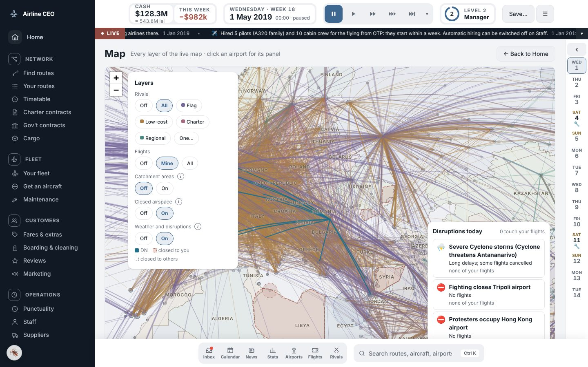
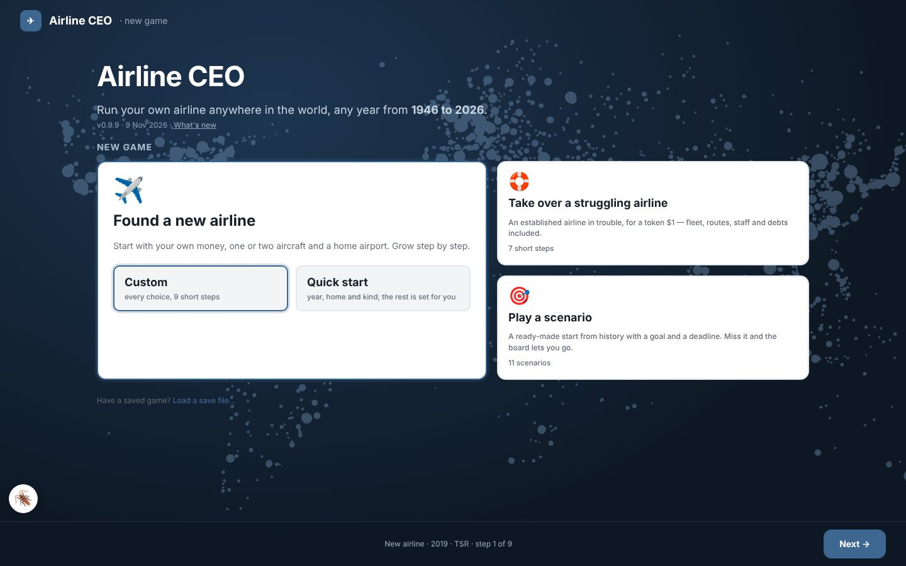
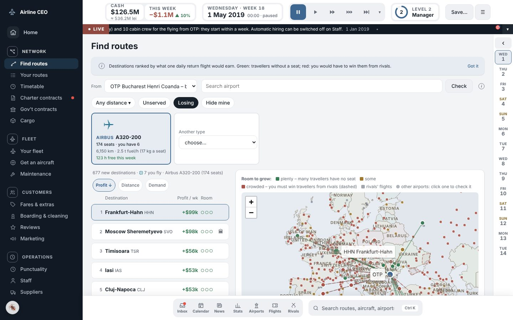
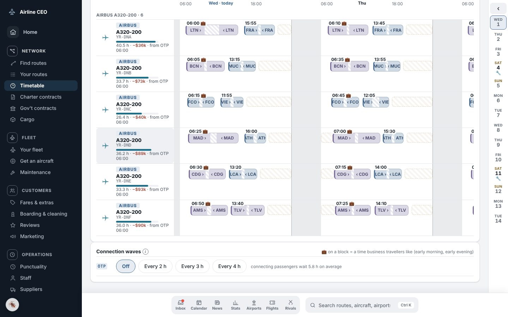
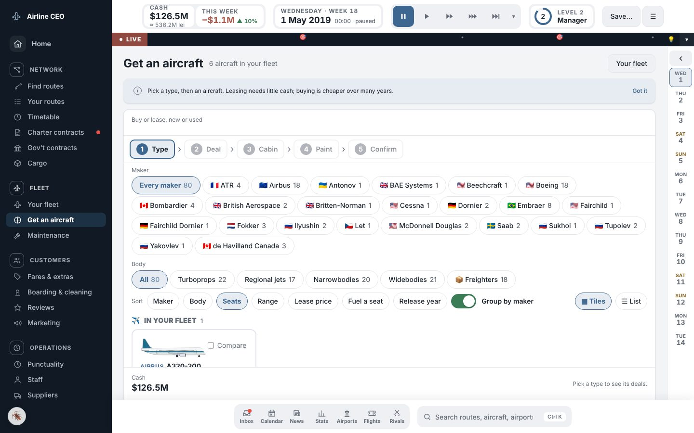
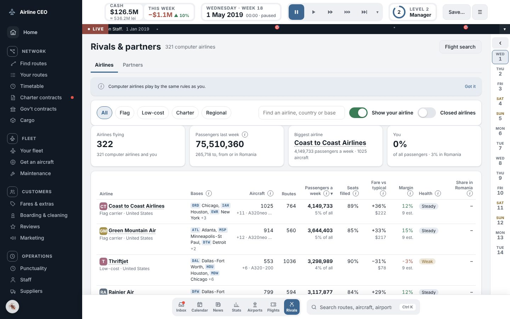

# ✈️ Airline CEO

**Run your own airline anywhere in the world, any year from 1946 to 2026 — right in your browser.**

*This page describes release **v0.9.14** (11 Nov 2026).* No account needed; saves stay in your own browser.

One player airline against **300+ computer airlines** in a living market. Passengers choose between you, your rivals and the train; fuel, wars, recessions and pandemics hit when history says they did. Deep simulation, shown with maps, cards and charts instead of spreadsheets.

## At a glance
| 🌍 **2,170** airports | 🏙️ **1,822** cities | ✈️ **123** aircraft · 35 makers | 🏢 **~320** rival airlines |
|:---:|:---:|:---:|:---:|
| 📅 **1946–2026** everywhere | 📰 **1,386** real events | 🎯 **11** scenarios | 🏆 **20** levels · **40** achievements |

Every country and territory has at least one airport; rival airlines are fictional and different in every game.

## How you play
<table>
<tr>
<td width="50%"> <b>Start your way</b> — found a new airline (custom or quick start), take over a struggling one for $1, or play a scenario with a goal and a deadline.</td>
<td width="50%"> <b>Find routes</b> — every destination ranked by what a daily flight would earn, with room to grow and rivals on the map.</td>
</tr>
<tr>
<td> <b>Build the timetable</b> — drag flights between days and aircraft; slots, night closures and business-friendly hours are marked.</td>
<td> <b>Grow the fleet</b> — buy or lease, new or used, from the DC-3 to the A350; design the cabin and paint it in your colours.</td>
</tr>
</table>

- 🛫 **Get certified first** — company, licence and proving flights before the first ticket (or skip with quick start).
- 💵 **Price and sell** — fares per class, bag and seat fees, catering, marketing, partner airlines for connections, charter and cargo contracts, government-subsidised routes.
- 👩‍✈️ **Lead people** — pilots, cabin crew and engineers, pay and union claims, a board that can fire you.
- 🏦 **Run the money** — loans, shares, dividends and full accounts; three months without cash and it's over.
- ⚠️ **Live with the world** — weather, airspace closures, accidents at real rates, fuel shocks, festivals and seasons, rivals that announce their moves, grow and go bust.

## Why it feels real
- **Passengers choose** every week between business, leisure and budget trips — fares, times, frequency, connections, trains, or staying home.
- **Real-world numbers** for demand: populations, incomes, tourism and traffic since 1946. Every data row is marked *sourced*, *estimated* or *guess*.
- **Real costs**: the year's fuel price, crews, maintenance, airport fees, leases, inflation and 190+ currencies. Long routes fly with fuel stops when the aircraft can't make it.
- **Real accounts**: double-entry books for every airline, checked every simulated day.

## Technical specs
| | |
|---|---|
| Delivery | **One HTML file** (~2.8 MB), no server, no install; the internet is used only for the map library |
| Code | ~37,000 lines of plain JavaScript, no frameworks; the simulation runs in a background thread so the screen never freezes |
| Speed (MacBook Air) | new game ~15 s · a game month ~8–14 s |
| Memory | ~400 MB of game data for the whole 2019 world; the browser tab peaks around 1.3–1.5 GB |
| Saves | in the browser, 5 named slots, compressed |
| Works on | any recent desktop browser (Chrome, Edge, Firefox, Safari); 8 GB RAM recommended |

The same game always gives the same result (checked by an automated play test), and every text is in one file, ready for translation.

## Coming next
- 🎮 **Steam 1.0** — desktop version with saves on disk, Steam achievements, cloud saves and leaderboards; this browser version stays as a free demo.
- ⚡ **Faster and lighter** — a game month under 5 s and less memory.
- 🛬 **Airport view** of your bases, with your aircraft at the stands; hand-drawn aircraft art.
- 📈 Stakes in rivals and hostile takeovers, daughter airlines abroad, cheap-early / dear-late fares, more scenarios.

## Release notes
<!-- releases:start -->

<b>Release notes</b> — 56 releases, latest <b>v0.9.14</b> (11 Nov 2026). Click to open.

| Release | Date | What changed |
|---|---|---|
| **v0.9.14** | 11 Nov 2026 | New airlines by region, pages match the new designs |
| **v0.9.13** | 11 Nov 2026 | Short trips and fares, every airport flown, rivals survive 2020 |
| **v0.9.12** | 10 Nov 2026 | Find routes rebuilt, redesigned pages, early-era history |
| **v0.9.11** | 9 Nov 2026 | Wider pop-ups; Find routes rows with rivals and travellers; route pop-up tidied |
| **v0.9.10** | 9 Nov 2026 | New top and bottom bars; Maintenance page rebuilt; Ground services; lessor offers in Get an aircraft; many screen fixes |
| **v0.9.9** | 9 Nov 2026 | Fuel stops on long routes; cleaner look on every screen; Brazil regions; shorter runways; rivals on short routes; old saves fixed; many fixes |
| **v0.9.8** | 8 Nov 2026 | Departures spread 5 min apart; Boarding & cleaning Apply per type; Save button; map bubbles grow on zoom; When it flies in the route pop-up; fixes; all text in one place for translation |
| **v0.9.7** | 8 Nov 2026 | Rivals announce their moves; 52 new airports; What's new window; better estimates; real runway lengths; busier 1950s; a year of statistics; used prices fall after production ends |
| **v0.9.6** | 8 Nov 2026 | Aircraft rents by year: older types like the A340 and 747-400 rent like new aircraft when new; rent falls slower with age and faster once a type is out of production |
| **v0.9.5** | 7 Nov 2026 | Rival airlines fly from day 1 again (their figures on day 1 were empty); failing checks fixed |
| **v0.9.4** | 7 Nov 2026 | Timetable rebuilt: drag a flight to another day or aircraft; route set-up suggests departure times with both legs; Group by on Your routes and Your fleet |
| **v0.9.3** | 7 Nov 2026 | Planned turnaround per aircraft type; asks whether routes already flying follow; a route's own turnaround in route set-up and the route pop-up |
| **v0.9.2** | 7 Nov 2026 | Route estimates before aircraft rent; friends' reports 58–117 fixed |
| **v0.91.1** | 7 Nov 2026 | Bars swapped: money, date and speeds at the top; quick pages and search at the bottom; all centred |
| **v0.92** | 7 Nov 2026 | Search field in the top bar, side menu shows every page with icons, Calendar next to Inbox, bottom bar centred |
| **v0.91** | 7 Nov 2026 | Rebrand with two colours, route money a week, lease call-off costs the deposit, crews hired for you below level 6, 'what changed' names fares and costs |
| **r38** | 7 Nov 2026 | Leases arrive sooner (3–7 days used, 10–14 new or widebody); computer airlines' leases wait too |
| **r37** | 7 Nov 2026 | Start year without the typing box; no real airline names in seat and website descriptions |
| **r36** | 7 Nov 2026 | Friends' reports 27–57: bottom bar, presets-only start screen, Market compare and fixes, Find routes sort/search/all airports, leases arrive in 1–4 weeks |
| **v0.9a** | 6 Nov 2026 | Version 0.9a: no real airline names left in the history news source files |
| **v0.9** | 6 Nov 2026 | Version 0.9: the whole world playable from 1946 in most areas; history news source files cleaned (decision 411) |
| **r35** | 6 Nov 2026 | Plain names for branded events (Olympics and World Cups keep theirs); history news told twice merged into one; scenario intros without real airline names |
| **r34** | 6 Nov 2026 | New side menu (one bar, categories drop their pages on hover, airline badge) and new top bar (quick pages, cash and clock, level, speeds with Next); phone tab bar |
| **r33** | 6 Nov 2026 | History: the Middle East, China/Hong Kong/Taiwan/Macau/Mongolia and West and Central Africa playable from 1946, with their own growth curves (H5, H7, H11) |
| **r32** | 6 Nov 2026 | Levels 1–20 with ranks and a level-up screen, Coming up page and event news, one impact block everywhere, Staff on one page with union claims |
| **r31** | 6 Nov 2026 | UI rebuild R12–R14: new start screen, rethought Bank, Shareholders, Career, My airline, Progress, Ctrl K search |
| **r30** | 6 Nov 2026 | Friends' reports 23–26: new-route aircraft order, 🪳 back bottom-left, scrolling news ticker, range and fuel on plane cards; news when aircraft go on sale, stop production or leave service |
| **r29** | 6 Nov 2026 | Find routes: a 777 or A350 from a hub now finds long-haul routes (cargo and connecting fares counted); India 1953–1993 one airline per route |
| **r28** | 6 Nov 2026 | UI R6–R9: route, aircraft, airport and rival pop-ups; new route in three steps; Get an aircraft replaces Buy & lease; History H2 (Canada, Mexico, Central America from 1946), H5, H6, runway history |
| **r27** | 6 Nov 2026 | UI rebuild R3–R5 merged with the latest world: Home, Statistics, full-screen map, Inbox with four levels and the guided first month, skip summary, 14-day timeline, live ticker |
| **r26** | 6 Nov 2026 | UI rebuild R3–R5: Home with live map and data wall, Statistics, full-screen map, Inbox with four levels and the guided first month, skip summary, 14-day timeline and live ticker; top bar fixes |
| **r25** | 5 Nov 2026 | New look: side menu with the date and clock, new top bar (pause, ▶, ▶▶, ▶▶▶ and Skip to the next event), pop-ups that stack, Inbox and Statistics pages; history from 1946 in the United States and South America |
| **r24** | 5 Nov 2026 | QA fixes from friends' reports: Timetable from level 1, 1× = 10 min a day, widebodies in Find routes (A–Z), no paid seat choice before 2006, loan repay asks first, maps stay inside their edges, charter cards without the reference type; runway lengths checked against Wikipedia (Cluj 2,100 m and 222 more) |
| **r23** | 4 Nov 2026 | The whole world: Oceania and Sub-Saharan Africa join; every country has an airport |
| **r22** | 4 Nov 2026 | 🪳 Report a problem is now a floating button in the bottom-left corner of every screen |
| **r21** | 4 Nov 2026 | 🐞 Report a problem: tips on writing a report; first release with the button online |
| **r20** | 4 Nov 2026 | 🐞 Report a problem button in the top bar: one line, sent to the owner's bug-report form with the release, game date and page |
| **r19** | 4 Nov 2026 | All of Asia: China, Japan, the Koreas, Taiwan, Southeast Asia, Siberia and Central Asia now playable from 1990 |
| **r18** | 4 Nov 2026 | Small fixes: smaller saves, withdraw a route application, East German airline closes 1991, flight numbers no longer repeat, Open world rivals and wars, Prague in The Wall comes down |
| **r17** | 4 Nov 2026 | Two more scenarios: Pandemic 2020 and Gulf hub 1995 |
| **r16** | 4 Nov 2026 | Scenarios: The Wall comes down, Rescue a flag carrier, Low-cost revolution, Oil shock — a goal, a deadline and a medal |
| **r15** | 4 Nov 2026 | Accidents and incidents: small incidents, serious accidents and crashes at real-world rates for the year; insurance and reputation; rivals too; Safety card on My airline |
| **r14** | 4 Nov 2026 | Game modes: Real world, Open world (switch off route approvals, fixed fares, ownership rules, closed airspace) and Sandbox |
| **r13** | 4 Nov 2026 | Cheats in the ☰ menu: money, unlock everything, instant deliveries and refits, no breakdowns or strikes (using one stops achievements and level points) |
| **r12** | 4 Nov 2026 | My airline page: your airline as a rival sees it, each figure ranked against your competitors, identity and brand below |
| **r11** | 4 Nov 2026 | Getting an aircraft in six screens (maker, type, new or used, specs and options, cabin, registration) with the price at the bottom; saved cabins; registration ranges per aircraft family |
| **r10** | 4 Nov 2026 | UI pass: in-game dialogs instead of browser pop-ups; pay confirmations; new crew page; route settings as numbered steps; short sliders with typed values; dashboard tiles open full charts; Find routes tinted cards and hide switch; Gov't contracts; aircraft drawings redrawn (fin, cockpit, windows, freighters) |
| **r9** | 4 Nov 2026 | Reorganise all flights never adds slot or night problems; charter reminders 30 and 7 days before start; short-runway warning (London City); Find routes list follows the window |
| **r8** | 4 Nov 2026 | Charter airlines: short-notice contracts, and a new charter airline starts with one contract signed (decision 59) |
| **r7** | 4 Nov 2026 | Charter airlines get twice the tour-operator work (decision 58); fixed a crash loading games saved during a festival (B7); charter offers check runways (B8) |
| **r6** | 3 Nov 2026 | Levels come four times slower (owner's comment 26) |
| **r5** | 3 Nov 2026 | Government contracts (Europe): bid to fly subsidised routes to small and island airports; page under Network, opens at level 3 |
| **r4** | 3 Nov 2026 | Block 3: flights to one place spread over the day, Boarding & cleaning per aircraft type, Reorganise all flights, five named save slots; Services renamed Fares & extras |
| **r3** | 3 Nov 2026 | UI pass block 2: full-screen newspaper, Services (typical estimates, apply to flown routes?, route lock), Staff (tabs, pay per role, crews hired at once), slot fees, market built in the background, takeover map, rival cards, charter costs per type, Maintenance by family, brand colours and logos, drawings |
| **r2** | 3 Nov 2026 | UI pass block 1 (Find routes, route pop-up, Buy & Lease, Your fleet by type) and r1 play fixes (business fare estimate, takeover list and fleet ages, spares on 1-day checks, Rivals and Flight search from level 1, map labels by zoom) |
| **r1** | 3 Nov 2026 | Owner's play fixes (charters from day 1, approvals in a week, slots, night closures, start screen, dashboard), far cities in two halves |

<!-- releases:end -->

